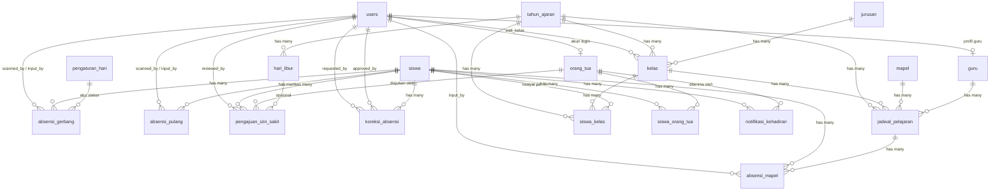

# DESAIN SISTEM ABSENSI SISWA — UJIKOM (SMK) [REVISI 3]

> Dokumen perancangan database, aturan bisnis, dan alur sistem. **Menyatukan** PRD fungsional
> (`PrdAndDesign/prd_smk_attendance_os.md`) dengan desain database, dan memuat **seluruh keputusan
> hasil review bersama pemilik proyek**. Revisi 2 tersimpan di `DESAIN_SISTEM_ABSENSI_rev2_backup.md`.

---

## 1. Spesifikasi Guru (Sumber Kebutuhan)

> **Input:** Scan QR Code, kartu pelajar, sidik jari, atau input manual oleh guru mata pelajaran/wali kelas, serta data jadwal pelajaran.
> **Proses:** Pencocokan waktu absensi dengan jadwal aktif, validasi status kehadiran (Hadir, Izin, Sakit, atau Alpa), dan penyimpanan ke database sekolah.
> **Output:** Rekapitulasi absensi harian, mingguan, dan bulanan, laporan kehadiran untuk wali kelas/BK, serta notifikasi kehadiran ke orang tua/wali.

---

## 2. Keputusan Scope (hasil review — FINAL)

| No | Keputusan | Nilai |
|----|-----------|-------|
| 1 | Teknologi scan | **QR via kamera browser** (html5-qrcode). Kartu pelajar dicetak QR. |
| 2 | Scope input lain | **Sidik jari & RFID dicoret** (butuh hardware). Dicatat sebagai batasan di PRD. Input manual NISN/nama tetap ada sebagai fallback. |
| 3 | Notifikasi orang tua | **Log database + antrean simulasi** (`NotifikasiGateway` interface, implementasi `DatabaseGateway`). Siap diswap ke WA gateway nyata nanti. |
| 4 | Tailwind CSS | **v4** (sudah terpasang, token via `@theme` mengikuti `DESIGN.md`). |
| 5 | Database | **MySQL**, `APP_TIMEZONE=Asia/Jakarta`, scheduler aktif. |
| 6 | Setting jam | **PER HARI** (`pengaturan_hari`) — tiap hari punya jam sendiri, diubah via UI. Bukan global. PRD hanya berisi contoh nilai. |
| 7 | Hari libur | Modul **Hari Libur Rutin** (per hari via UI) + **Hari Libur Rentang** (tanggal, libur nasional/acara). |
| 8 | Kelas & tahun ajaran | Pivot **`siswa_kelas`** — riwayat kelas siswa per tahun ajaran terlacak. |
| 9 | Status izin/sakit di gerbang | Enum gerbang ditambah **`izin`, `sakit`** (diisi otomatis saat pengajuan disetujui). |
| 10 | Approval | Pengajuan izin/sakit → **wali kelas**. Koreksi absensi → **wali kelas approve, admin final**. |
| 11 | Jendela pulang | **Per hari** mengikuti `pengaturan_hari` masing-masing hari. |
| 12 | Ekspor laporan | **PDF + XLSX** tetap masuk scope (syarat Ujikom). |
| 13 | Auth | Auth Blade manual (session + guard role), tanpa starter kit — mengikuti design system sendiri. |

**Batasan yang dipresentasikan sebagai "rencana pengembangan" di Ujikom:** sidik jari, RFID,
WhatsApp gateway nyata, mode offline daemon.

---

## 3. Tiga Jenis Absensi

| Jenis Absensi | Pelaksana | Lokasi | Status |
|--------------|-----------|--------|--------|
| **Absen Gerbang** (masuk) | OSIS / Piket | Gerbang sekolah | `hadir_tepat_waktu`, `terlambat`, `alpa` (auto), `izin`, `sakit` |
| **Absen Mapel** | Guru / Wali Kelas | Kelas | `hadir`, `izin`, `sakit`, `alpa`, `terlambat` |
| **Absen Pulang** | OSIS / Piket | Gerbang sekolah | `pulang`, `pulang_cepat`, `kabur` (auto), `belum_absen` |

- **Metode** di ketiga tabel absensi: `manual`, `qr` (extensible untuk `kartu`, `sidik_jari` di masa depan).
- **Hierarki status rekap harian:** status kehadiran resmi harian = **absensi gerbang**. Absensi mapel = rincian per jam pelajaran. Absensi pulang = kolom terpisah. Laporan "siswa bermasalah" (BK) = gabungan ketiganya.

---

## 4. Role & Hak Akses

| Role | Tanggung Jawab Utama |
|------|---------------------|
| **Admin** | Kelola semua master data & pengaturan, **final approval** koreksi, override, semua laporan, ekspor |
| **Guru Mapel** | Absen mapel kelas/jadwal yang diampu, ajukan koreksi, lihat laporan kelasnya |
| **Wali Kelas** | Absen mapel, **approve pengajuan izin/sakit**, **approve koreksi**, laporan kelas |
| **BK** | Laporan kehadiran semua kelas, log siswa bermasalah |
| **OSIS** | Scan absensi gerbang & pulang di gerbang |
| **Piket** | Scan gerbang/pulang, **set `pulang_cepat` + karcis**, input manual lewat jam tutup, ajukan koreksi |
| **Orang Tua** | Ajukan izin/sakit (upload bukti), lihat notifikasi & rekap anak |

**Matriks approval:**

| Aksi | Pengusul | Approver |
|------|----------|----------|
| Pengajuan izin/sakit | Orang tua | Wali kelas (admin boleh override) |
| Koreksi absensi | guru, osis, piket, bk | Wali kelas atau admin |
| Koreksi absensi | wali kelas | Admin |
| Koreksi absensi | admin | Diterapkan langsung (dicatat di log audit) |
| Set `pulang_cepat` | Piket | Langsung (wewenang piket, wajib isi keterangan + karcis) |

---

## 5. Entity Relationship Diagram (ERD)



---

## 6. Struktur Tabel Database

> Semua tabel memakai `timestamps`. **Soft delete hanya untuk master data & users.**
> Tabel absensi, pengajuan, koreksi, dan notifikasi **tidak dihapus** (perubahan lewat approval/audit).

### 6.1 `users` (Laravel default — diperpanjang)
| Kolom | Tipe | Keterangan |
|-------|------|------------|
| id | bigInteger PK | |
| name | string | |
| email | string unique | |
| password | string | |
| role | enum | `admin`, `guru`, `wali_kelas`, `bk`, `orang_tua`, `osis`, `piket` |
| is_active | boolean default true | |
| timestamps, soft_deletes | | |

### 6.2 `tahun_ajaran`
| Kolom | Tipe | Keterangan |
|-------|------|------------|
| id | bigInteger PK | |
| nama | string | Contoh: 2026/2027 |
| tanggal_mulai | date | |
| tanggal_selesai | date | |
| is_active | boolean default false | **Hanya satu** tahun ajaran aktif (divalidasi di aplikasi) |
| timestamps, soft_deletes | | |

### 6.3 `jurusan`
| Kolom | Tipe | Keterangan |
|-------|------|------------|
| id | bigInteger PK | |
| nama | string | Contoh: Teknik Komputer Jaringan |
| singkatan | string unique | Contoh: TKJ |
| timestamps, soft_deletes | | |

### 6.4 `mapel`
| Kolom | Tipe | Keterangan |
|-------|------|------------|
| id | bigInteger PK | |
| kode_mapel | string unique | MTK-101 |
| nama_mapel | string | Matematika |
| jumlah_jam_per_minggu | smallInteger default 2 | |
| timestamps, soft_deletes | | |

### 6.5 `guru`
| Kolom | Tipe | Keterangan |
|-------|------|------------|
| id | bigInteger PK | |
| user_id | bigInteger FK → users.id unique | |
| nip | string unique | |
| telepon | string nullable | |
| mapel_utama_id | bigInteger FK → mapel.id nullable | |
| timestamps, soft_deletes | | |

### 6.6 `kelas`
| Kolom | Tipe | Keterangan |
|-------|------|------------|
| id | bigInteger PK | |
| tahun_ajaran_id | bigInteger FK → tahun_ajaran.id | Kelas melekat pada tahun ajaran |
| jurusan_id | bigInteger FK → jurusan.id | |
| nama_kelas | string | Contoh: X TKJ 1 |
| wali_kelas_id | bigInteger FK → users.id nullable | |
| active | boolean default true | |
| timestamps, soft_deletes | | |

**Index unik:** `(tahun_ajaran_id, nama_kelas)`

### 6.7 `siswa`
| Kolom | Tipe | Keterangan |
|-------|------|------------|
| id | bigInteger PK | |
| nisn | string unique | |
| nis | string unique | |
| qr_code | string unique | **Payload QR kartu pelajar** (mis. `SISWA-{id}-{nisn}`) |
| nama | string | |
| jenis_kelamin | enum | `laki-laki`, `perempuan` |
| foto | string nullable | Path foto opsional |
| active | boolean default true | Siswa nonaktif = tidak discan, tidak ikut auto-alpa |
| timestamps, soft_deletes | | |

> **`kelas_id` TIDAK ada di `siswa`** — keanggotaan kelas lewat pivot `siswa_kelas`.

### 6.8 `siswa_kelas` (riwayat per tahun ajaran)
| Kolom | Tipe | Keterangan |
|-------|------|------------|
| id | bigInteger PK | |
| siswa_id | bigInteger FK → siswa.id | |
| kelas_id | bigInteger FK → kelas.id | |
| tahun_ajaran_id | bigInteger FK → tahun_ajaran.id | |
| is_active | boolean default true | Keanggotaan aktif tahun ini |
| timestamps | | |

**Index unik:** `(siswa_id, tahun_ajaran_id)` · **Index:** `(kelas_id, tahun_ajaran_id)`

### 6.9 `orang_tua`
| Kolom | Tipe | Keterangan |
|-------|------|------------|
| id | bigInteger PK | |
| user_id | bigInteger FK → users.id nullable unique | Akun login (dibuat admin) |
| nama | string | |
| telepon | string | |
| email | string nullable | |
| timestamps, soft_deletes | | |

### 6.10 `siswa_orang_tua`
| Kolom | Tipe | Keterangan |
|-------|------|------------|
| id | bigInteger PK | |
| siswa_id | bigInteger FK → siswa.id | |
| orang_tua_id | bigInteger FK → orang_tua.id | |
| hubungan | enum | `ayah`, `ibu`, `wali` |
| is_primary | boolean default false | Notifikasi utama dikirim ke yang primary |
| timestamps | | |

**Index unik:** `(siswa_id, orang_tua_id)`

### 6.11 `pengaturan_hari` ⭐ (PENGGANTI `setting_absensi` global)
> **7 baris (Senin–Minggu), semuanya bisa dikustom via UI.** Jam yang `NULL` = belum dikonfigurasi → scan diblokir dengan pesan jelas.

| Kolom | Tipe | Keterangan |
|-------|------|------------|
| id | bigInteger PK | |
| hari | enum unique | `senin` … `minggu` |
| status_hari | enum | **`masuk`**, **`libur`** ← modul Hari Libur Rutin |
| buka_scan_gerbang | time nullable | Gerbang mulai menerima scan masuk |
| batas_tepat_waktu | time nullable | ≤ ini = `hadir_tepat_waktu` |
| toleransi_menit | smallInteger default 15 | Setelah batas = `terlambat` (informatif untuk UI) |
| jam_tutup_gerbang | time nullable | Setelah ini scan QR masuk **ditolak** (input manual petugas = `terlambat`) |
| jam_auto_alpa | time nullable | Job auto-alpa berjalan pada jam ini |
| mulai_scan_pulang | time nullable | Awal jendela scan pulang |
| akhir_scan_pulang | time nullable | Akhir jendela scan pulang → job auto-kabur |
| keterangan | string nullable | Catatan (mis. "Jumat pendek") |
| timestamps | | |

**Contoh seed:** Senin–Kamis: buka 06:30, tepat-waktu 07:00, tutup 07:30, alpa 08:00, pulang 14:00–14:50 · Jumat: alpa 07:30, pulang 11:30–12:45 · Sabtu/Minggu: `libur`.

### 6.12 `hari_libur` (HANYA rentang/tanggal)
| Kolom | Tipe | Keterangan |
|-------|------|------------|
| id | bigInteger PK | |
| tahun_ajaran_id | bigInteger FK → tahun_ajaran.id | |
| tanggal_mulai | date | |
| tanggal_selesai | date | (nullable = satu hari) |
| keterangan | string | Libur Nasional, Acara Sekolah, Cuti Tengah Semester |
| status_masuk | enum | **`tidak_masuk`** (libur mutlak) / **`masuk`** (kegiatan — paksa hari aktif) |
| is_active | boolean default true | |
| timestamps | | |

### 6.13 `jadwal_pelajaran`
| Kolom | Tipe | Keterangan |
|-------|------|------------|
| id | bigInteger PK | |
| tahun_ajaran_id | bigInteger FK → tahun_ajaran.id | |
| kelas_id | bigInteger FK → kelas.id | |
| mapel_id | bigInteger FK → mapel.id | |
| guru_id | bigInteger FK → guru.id | |
| hari | enum | `senin` … `minggu` |
| jam_ke | smallInteger | 1 s.d. 8 |
| jam_mulai | time | 07:00:00 |
| jam_selesai | time | 07:45:00 |
| ruangan | string nullable | |
| semester | enum | `ganjil`, `genap` |
| active | boolean default true | |
| timestamps, soft_deletes | | |

**Index unik:** `(kelas_id, hari, jam_ke, tahun_ajaran_id, semester)`
**Validasi aplikasi (wajib):** `guru` dan `ruangan` tidak boleh bentrok pada `(hari, jam_ke, tahun_ajaran_id, semester)`.

### 6.14 `absensi_gerbang`
| Kolom | Tipe | Keterangan |
|-------|------|------------|
| id | bigInteger PK | |
| siswa_id | bigInteger FK → siswa.id | |
| tanggal | date | |
| waktu_scan | datetime nullable | NULL untuk baris auto (alpa) & approve izin |
| status | enum | `hadir_tepat_waktu`, `terlambat`, `alpa`, **`izin`**, **`sakit`** |
| metode | enum | `manual`, `qr` |
| scanned_by | bigInteger FK → users.id nullable | OSIS / Piket / input manual |
| keterangan | text nullable | |
| timestamps | | |

**Index unik:** `(siswa_id, tanggal)` · **Index:** `(tanggal)`, `(status, tanggal)`

### 6.15 `absensi_mapel`
| Kolom | Tipe | Keterangan |
|-------|------|------------|
| id | bigInteger PK | |
| siswa_id | bigInteger FK → siswa.id | |
| jadwal_pelajaran_id | bigInteger FK → jadwal_pelajaran.id | |
| tanggal | date | |
| status | enum | `hadir`, `izin`, `sakit`, `alpa`, `terlambat` |
| metode | enum | `manual`, `qr` |
| input_by | bigInteger FK → users.id | |
| keterangan | text nullable | |
| timestamps | | |

**Index unik:** `(siswa_id, jadwal_pelajaran_id, tanggal)` · **Index:** `(tanggal)`

### 6.16 `absensi_pulang`
| Kolom | Tipe | Keterangan |
|-------|------|------------|
| id | bigInteger PK | |
| siswa_id | bigInteger FK → siswa.id | |
| tanggal | date | |
| waktu_scan | datetime nullable | NULL untuk baris `belum_absen` awal & auto |
| status | enum | `pulang`, `pulang_cepat`, `kabur`, `belum_absen` |
| metode | enum | `manual`, `qr` |
| scanned_by | bigInteger FK → users.id nullable | |
| kode_karcis | string nullable unique | Untuk pulang cepat (dicetak/ditunjukkan ke penjaga) |
| keterangan | text nullable | Contoh: "Izin pulang cepat - sakit", "Dikeluarkan orang tua" |
| timestamps | | |

**Index unik:** `(siswa_id, tanggal)` · **Index:** `(tanggal)`, `(status, tanggal)`

> **Model baris:** setiap hari aktif, job awal hari **membuat baris `absensi_pulang` `belum_absen`**
> untuk seluruh siswa aktif (pre-created). Scan meng-update baris. Sehingga auto-kabur cukup
> `UPDATE ... WHERE status='belum_absen'` — tanpa risiko duplikat.
> `absensi_gerbang` **tidak** pre-created (baris tercipta dari scan / approve izin / job alpa).

### 6.17 `pengajuan_izin_sakit`
| Kolom | Tipe | Keterangan |
|-------|------|------------|
| id | bigInteger PK | |
| siswa_id | bigInteger FK → siswa.id | |
| orang_tua_id | bigInteger FK → orang_tua.id | |
| jenis | enum | `izin`, `sakit` |
| tanggal_mulai | date | |
| tanggal_selesai | date | |
| alasan | text | |
| bukti_foto | string nullable | Path foto surat dokter/izin |
| status | enum | `pending`, `disetujui`, `ditolak` |
| reviewed_by | bigInteger FK → users.id nullable | Wali kelas (admin boleh override) |
| reviewed_at | datetime nullable | |
| catatan | text nullable | Alasan penolakan |
| timestamps | | **Tanpa soft delete** |

### 6.18 `koreksi_absensi`
| Kolom | Tipe | Keterangan |
|-------|------|------------|
| id | bigInteger PK | |
| **absensi_type** | enum | **`gerbang`, `mapel`, `pulang`** (tipe referensi — polymorphic) |
| **absensi_id** | bigInteger | ID baris di tabel sesuai `absensi_type` |
| siswa_id | bigInteger FK → siswa.id | Denormalisasi untuk query laporan |
| tanggal | date | Denormalisasi |
| status_lama | enum | Enum gabungan sesuai jenis absen |
| status_baru | enum | Enum gabungan sesuai jenis absen |
| alasan | text | |
| bukti_foto | string nullable | |
| requested_by | bigInteger FK → users.id | |
| status | enum | `pending`, `disetujui`, `ditolak` |
| approved_by | bigInteger FK → users.id nullable | |
| catatan_review | text nullable | |
| reviewed_at | datetime nullable | |
| timestamps | | **Tanpa soft delete** |

### 6.19 `notifikasi_kehadiran`
| Kolom | Tipe | Keterangan |
|-------|------|------------|
| id | bigInteger PK | |
| siswa_id | bigInteger FK → siswa.id | |
| orang_tua_id | bigInteger FK → orang_tua.id | Penerima |
| **absensi_type** | enum | `gerbang`, `mapel`, `pulang`, `pengajuan` |
| **absensi_id** | bigInteger | Referensi baris terkait |
| jenis | enum | `whatsapp`, `sms`, `push` (implementasi saat ini: log) |
| trigger_event | enum | `scan_masuk`, `scan_pulang`, `pulang_cepat`, `auto_alpa`, `auto_kabur`, `izin_sakit_disetujui`, `izin_sakit_ditolak`, `koreksi_disetujui` |
| pesan | text | Template sudah dirender |
| status | enum | `antre`, `terkirim`, `dibaca`, `gagal` |
| gateway | string | `database` (simulasi) — ganti `fonnte` dsb. nanti |
| waktu_kirim | datetime | |
| timestamps | | |

**Index:** `(siswa_id, orang_tua_id, status)`, `(status, waktu_kirim)`

### 6.20 `setting_sekolah` (hanya profil — untuk kop laporan)
| Kolom | Tipe | Keterangan |
|-------|------|------------|
| id | bigInteger PK | |
| kunci | string unique | `nama_sekolah`, `alamat_sekolah`, `telepon_sekolah`, `kepala_sekolah`, `logo_sekolah` |
| nilai | string | |
| keterangan | text nullable | |
| timestamps | | |

> **Dihapus:** `setting_absensi` (diganti `pengaturan_hari`), `setting_sekolah.hari_libur_rutin`
> (diganti modul `pengaturan_hari.status_hari`), `hari_libur.jenis=rutin`.

---

## 7. Aturan Bisnis (Rule Engine)

### 7.1 Penentuan hari aktif / libur — **precedence**
1. Tanggal berada di rentang `hari_libur` dengan `status_masuk = tidak_masuk` → **LIBUR MUTLAK**
   (scan diblokir, semua job otomatis diskip).
2. `hari_libur` rentang dengan `status_masuk = masuk` → **HARI AKTIF** (kegiatan), pakai
   `pengaturan_hari` hari tersebut — admin wajib mengisi kolom jam hari itu (jika `NULL` → scan diblokir
   dengan pesan *"Jam absensi hari ini belum dikonfigurasi"*).
3. `pengaturan_hari[hari].status_hari = libur` → **LIBUR RUTIN** (job diskip, scan diblokir).
4. Selain itu → **HARI AKTIF**, semua aturan waktu diambil dari `pengaturan_hari` hari itu.

### 7.2 Absen Gerbang (masuk)
Siswa scan QR → cek hari aktif (7.1) → cek `waktu_scan` terhadap setting hari itu:

| Kondisi | Aksi |
|---------|------|
| Sebelum `buka_scan_gerbang` | ❌ Blokir: "Gerbang belum dibuka" |
| `buka_scan_gerbang` … `batas_tepat_waktu` | ✅ `hadir_tepat_waktu` |
| Setelah `batas_tepat_waktu` … `jam_tutup_gerbang` | ✅ `terlambat` |
| Setelah `jam_tutup_gerbang`, **scan QR** | ❌ Blokir: "Gerbang ditutup — lapor petugas piket" |
| Setelah `jam_tutup_gerbang`, **input manual petugas** (piket/admin) | ✅ `terlambat` + `keterangan` wajib |
| Baris sudah ada (sudah absen) | ⚠️ Info: "Sudah absen jam HH:MM" (idempoten) |
| Siswa `active = false` / bukan hari ini | ❌ Blokir |
| Baris `alpa` sudah dibuat job | ❌ Blokir → hanya bisa lewat **koreksi absensi** |

Setelah sukses → notifikasi `scan_masuk` ke orang tua.

### 7.3 Absen Mapel (guru di kelas)
1. Guru pilih **jadwal hari ini** yang diampu (kelas + jam_ke + hari + semester aktif).
2. Daftar siswa kelas (dari `siswa_kelas` tahun ajaran aktif) + status per siswa.
3. Aksi cepat: **"Set Semua Hadir"**, lalu koreksi per siswa: `hadir` / `terlambat` / `izin` / `sakit` / `alpa`.
4. Simpan dengan unique `(siswa_id, jadwal_id, tanggal)`, `input_by` = guru.
5. Notifikasi ortu untuk `izin` / `sakit` / `alpa`.

### 7.4 Absen Pulang
| Kondisi (pada hari aktif, baris pre-created `belum_absen`) | Aksi |
|---------|------|
| Scan **sebelum** `mulai_scan_pulang` | ❌ Blokir: "Belum waktunya pulang" |
| Scan dalam jendela `mulai_scan_pulang` … `akhir_scan_pulang` | ✅ `pulang` + notifikasi |
| **Piket** set `pulang_cepat` (kapan pun, wajib `keterangan`, dapat `kode_karcis`) | ✅ `pulang_cepat` + notifikasi |
| Setelah `akhir_scan_pulang`, baris masih `belum_absen` | Job **auto-kabur** → `kabur` (hanya jika gerbang hari itu `hadir_tepat_waktu`/`terlambat`) |
| Setelah `akhir_scan_pulang`, scan QR | ❌ Blokir: "Jendela pulang berakhir — gunakan koreksi" |

### 7.5 Job Otomatis (scheduler — cek tiap menit, idempoten via cache key per tanggal)
| Job | Waktu | Kerja |
|-----|-------|-------|
| **Pre-create absensi_pulang** | `buka_scan_gerbang` hari aktif | Insert `belum_absen` untuk semua siswa aktif di TA aktif |
| **Auto-Alpa** | `pengaturan_hari[hari].jam_auto_alpa` | Insert `absensi_gerbang` = `alpa` (anti-join: siswa **tanpa** baris gerbang hari ini, aktif, bukan hari libur). Baris `izin`/`sakit` yang sudah ada membuat siswa otomatis terlewat. |
| **Auto-Kabur** | `akhir_scan_pulang` + 1 menit | Update `absensi_pulang` `belum_absen` → `kabur` **hanya untuk siswa yang punya gerbang `hadir_tepat_waktu`/`terlambat`** hari itu. Siswa alpa/izin/sakit dibiarkan `belum_absen` (rekap menampilkan `-`). |
| **Dispatcher notifikasi** | Queue (database) | Kirim log antrean ke `NotifikasiGateway::send()` |

### 7.6 Pengajuan Izin/Sakit (Orang tua → Wali Kelas)
1. Ortu isi form: jenis, rentang tanggal, alasan, **upload foto bukti** → `pending` + notifikasi ke wali kelas.
2. **Wali kelas** setujui/tolak (admin boleh override). Jika tolak → `catatan` wajib.
3. **Efek persetujuan (untuk setiap tanggal dalam rentang, hari aktif saja):**
   - Buat/isi `absensi_gerbang` = `izin`/`sakit`;
   - **Jika baris `alpa` sudah terlanjur dibuat job → UPDATE jadi `izin`/`sakit`** (aturan anti race-condition dengan cron 08:00);
   - Buat/isi `absensi_mapel` semua jadwal hari itu = `izin`/`sakit`;
   - Baris `absensi_pulang` tetap `belum_absen` → job auto-kabur otomatis melewatkan (lihat 7.5);
   - Notifikasi ortu: `izin_sakit_disetujui`.

### 7.7 Koreksi Status Absensi (approval workflow)
1. Pengusul pilih jenis absen → baris absensi → status lama (otomatis) → status baru → alasan (+foto opsional).
2. Approval mengikuti **matriks §4** (wali kelas / admin final; admin langsung terapkan + audit).
3. Saat disetujui: update baris absensi → notifikasi ke ortu (`koreksi_disetujui`) + catat `approved_by`.

### 7.8 Rekap & Hierarki Status
- **Rekap harian/mingguan/bulanan** = agregasi on-the-fly (tanpa tabel materialisasi), di-cache bila perlu.
- Kolom **Kehadiran Harian** = status `absensi_gerbang` (utama); kolom rincian = mapel per jam; kolom **Pulang**.
- Jika gerbang `izin`/`sakit`/`alpa` → kolom pulang tampil **`-`** (tidak relevan).
- **Laporan wali kelas/BK:** jumlah hadir/terlambat/izin/sakit/alpa/kabur, % kehadiran per siswa,
  daftar siswa < **90%** (ambang kelulusan sesuai PRD) sebagai "siswa bermasalah".
- **Ekspor:** PDF (dompdf, kop sekolah dari `setting_sekolah`) dan XLSX per hari/minggu/bulan/semester.

---

## 8. Alur Proses Utama (ringkas)

```
SENIN–JUMAT (setting dari pengaturan_hari)
06:30  Gerbang buka → job pre-create absensi_pulang (belum_absen)
06:30–07:00  Scan QR → hadir_tepat_waktu → Notif WA-Log ke ortu
07:01–07:30  Scan QR → terlambat → Notif keterlambatan
>07:30  QR ditolak → input manual petugas piket (terlambat + keterangan)
07:00–…      Guru absen mapel per jadwal (set semua hadir + koreksi)
08:00  Job AUTO-ALPA (skip libur / izin-sakit / siswa nonaktif) → Notif ortu
14:00–14:50  Scan pulang → pulang | Piket set pulang_cepat + karcis
14:51  Job AUTO-KABUR (siswa hadir pagi tanpa scan pulang) → Notif ortu
```

---

## 9. Checklist Revisi 3

- [x] Tiga jenis absen (gerbang, mapel, pulang) tercakup + `metode` di ketiganya
- [x] Status lengkap termasuk `izin`/`sakit` di gerbang (aman dari auto-alpa)
- [x] **Setting jam PER HARI via UI** (`pengaturan_hari`), PRD hanya contoh
- [x] Modul **Hari Libur Rutin** (UI) + **Hari Libur Rentang** (tanggal, masuk/tidak_masuk)
- [x] Precedence libur tertulis & job otomatis diskip saat libur
- [x] Auto-alpa & auto-kabur via scheduler (idempoten, timezone Asia/Jakarta)
- [x] Jendela pulang per hari; anti race-condition approve vs cron
- [x] Pre-created baris `absensi_pulang` (`belum_absen`) — model baris eksplisit
- [x] Pengajuan izin/sakit ortu + foto bukti → approve wali kelas
- [x] Koreksi absensi: polymorphic + approval wali kelas → admin final
- [x] Pivot `siswa_kelas` — riwayat kelas per tahun ajaran
- [x] `qr_code` unik di siswa; notifikasi log + gateway interface
- [x] Rekap harian/mingguan/bulanan + laporan wali kelas/BK + ekspor PDF/XLSX
- [x] Validasi bentrok jadwal guru/ruangan (level aplikasi)
- [x] Scope batasan terdokumentasi (sidik jari, RFID, WA nyata, offline)

---

*Dibuat untuk UJIKOM — Sistem Absensi Siswa (Laravel 13, PHP 8.5, MySQL, Tailwind v4, Blade).*
