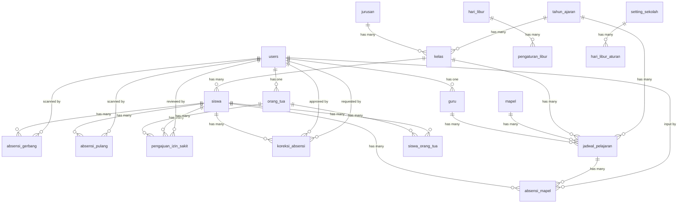

# DESAIN SISTEM ABSENSI SISWA — UJIKOM (SMK) [REVISI 2]

> Dokumen perancangan database dan alur sistem. **FIXED** — siap untuk eksekusi implementasi.

---

## 1. Spesifikasi Guru (Sumber Kebutuhan)

> **Input:** Scan QR Code, kartu pelajar, sidik jari, atau input manual oleh guru mata pelajaran/wali kelas, serta data jadwal pelajaran.  
> **Proses:** Pencocokan waktu absensi dengan jadwal aktif, validasi status kehadiran (Hadir, Izin, Sakit, atau Alpa), dan penyimpanan ke database sekolah.  
> **Output:** Rekapitulasi absensi harian, mingguan, dan bulanan, laporan kehadiran untuk wali kelas/BK, serta notifikasi kehadiran ke orang tua/wali.

---

## 2. Tiga Jenis Absensi

| Jenis Absensi | Pelaksana | Lokasi | Status |
|--------------|-----------|--------|--------|
| **Absen Gerbang** | OSIS / Piket | Gerbang sekolah (masuk) | `hadir_tepat_waktu`, `terlambat`, `alpa` (auto) |
| **Absen Mapel** | Guru / Wali Kelas | Kelas | `hadir`, `izin`, `sakit`, `alpa`, `terlambat` |
| **Absen Pulang** | OSIS / Piket | Gerbang sekolah (pulang) | `pulang`, `pulang_cepat`, `kabur` (auto), `belum_absen` |

---

## 3. Entity Relationship Diagram (ERD)

---

## 4. Struktur Tabel Database

### 4.1 `users` (Laravel default — diperpanjang)
| Kolom | Tipe | Keterangan |
|-------|------|------------|
| id | bigInteger PK | |
| name | string | |
| email | string unique | |
| password | string | |
| role | enum | `admin`, `guru`, `wali_kelas`, `bk`, `orang_tua`, `osis`, `piket` |
| timestamps | | |
| soft_deletes | | |

### 4.2 `tahun_ajaran` (BARU)
| Kolom | Tipe | Keterangan |
|-------|------|------------|
| id | bigInteger PK | |
| nama | string | Contoh: 2026/2027 |
| tanggal_mulai | date | |
| tanggal_selesai | date | |
| is_active | boolean default false | Hanya satu tahun ajaran aktif |
| timestamps | | |
| soft_deletes | | |

### 4.3 `jurusan`
| Kolom | Tipe | Keterangan |
|-------|------|------------|
| id | bigInteger PK | |
| nama | string | Contoh: Teknik Komputer Jaringan |
| singkatan | string unique | Contoh: TKJ |
| timestamps | | |
| soft_deletes | | |

### 4.4 `mapel`
| Kolom | Tipe | Keterangan |
|-------|------|------------|
| id | bigInteger PK | |
| kode_mapel | string unique | MTK-101 |
| nama_mapel | string | Matematika |
| jumlah_jam_per_minggu | smallInteger default 2 | |
| timestamps | | |
| soft_deletes | | |

### 4.5 `guru`
| Kolom | Tipe | Keterangan |
|-------|------|------------|
| id | bigInteger PK | |
| user_id | bigInteger FK → users.id unique | |
| nip | string unique | |
| nama | string | |
| telepon | string nullable | |
| mapel_utama_id | bigInteger FK → mapel.id nullable | |
| timestamps | | |
| soft_deletes | | |

### 4.6 `kelas`
| Kolom | Tipe | Keterangan |
|-------|------|------------|
| id | bigInteger PK | |
| tahun_ajaran_id | bigInteger FK → tahun_ajaran.id | |
| jurusan_id | bigInteger FK → jurusan.id | |
| nama_kelas | string | Contoh: X TKJ 1 |
| wali_kelas_id | bigInteger FK → users.id nullable | |
| active | boolean default true | |
| timestamps | | |
| soft_deletes | | |

### 4.7 `jadwal_pelajaran`
| Kolom | Tipe | Keterangan |
|-------|------|------------|
| id | bigInteger PK | |
| tahun_ajaran_id | bigInteger FK → tahun_ajaran.id | |
| kelas_id | bigInteger FK → kelas.id | |
| mapel_id | bigInteger FK → mapel.id | |
| guru_id | bigInteger FK → guru.id | |
| hari | enum | senin, selasa, rabu, kamis, jumat, sabtu, minggu |
| jam_ke | smallInteger | 1 s.d. 8 |
| jam_mulai | time | 07:00:00 |
| jam_selesai | time | 07:45:00 |
| ruangan | string nullable | |
| semester | enum | ganjil, genap |
| active | boolean default true | |
| timestamps | | |
| soft_deletes | | |

**Index unik:** `(kelas_id, hari, jam_ke, tahun_ajaran_id, semester)`

### 4.8 `siswa`
| Kolom | Tipe | Keterangan |
|-------|------|------------|
| id | bigInteger PK | |
| nisn | string unique | |
| nis | string unique | |
| nama | string | |
| jenis_kelamin | enum | laki-laki, perempuan |
| kelas_id | bigInteger FK → kelas.id | |
| active | boolean default true | |
| timestamps | | |
| soft_deletes | | |

### 4.9 `orang_tua`
| Kolom | Tipe | Keterangan |
|-------|------|------------|
| id | bigInteger PK | |
| nama | string | |
| telepon | string | |
| email | string nullable | |
| timestamps | | |
| soft_deletes | | |

### 4.10 `siswa_orang_tua`
| Kolom | Tipe | Keterangan |
|-------|------|------------|
| id | bigInteger PK | |
| siswa_id | bigInteger FK → siswa.id | |
| orang_tua_id | bigInteger FK → orang_tua.id | |
| hubungan | enum | ayah, ibu, wali |
| is_primary | boolean default false | |

### 4.11 `absensi_gerbang`
| Kolom | Tipe | Keterangan |
|-------|------|------------|
| id | bigInteger PK | |
| siswa_id | bigInteger FK → siswa.id | |
| tanggal | date | |
| waktu_scan | datetime | |
| status | enum | `hadir_tepat_waktu`, `terlambat`, `alpa` |
| scanned_by | bigInteger FK → users.id nullable | OSIS / Piket |
| keterangan | text nullable | |
| timestamps | | |

**Index unik:** `(siswa_id, tanggal)`

### 4.12 `absensi_mapel`
| Kolom | Tipe | Keterangan |
|-------|------|------------|
| id | bigInteger PK | |
| siswa_id | bigInteger FK → siswa.id | |
| jadwal_pelajaran_id | bigInteger FK → jadwal_pelajaran.id | |
| tanggal | date | |
| status | enum | `hadir`, `izin`, `sakit`, `alpa`, `terlambat` |
| metode | enum | `manual`, `kartu_pelajar` |
| input_by | bigInteger FK → users.id | |
| keterangan | text nullable | |
| timestamps | | |

**Index unik:** `(siswa_id, jadwal_pelajaran_id, tanggal)`

### 4.13 `absensi_pulang`
| Kolom | Tipe | Keterangan |
|-------|------|------------|
| id | bigInteger PK | |
| siswa_id | bigInteger FK → siswa.id | |
| tanggal | date | |
| waktu_scan | datetime nullable | |
| status | enum | `pulang`, `pulang_cepat`, `kabur`, `belum_absen` |
| scanned_by | bigInteger FK → users.id nullable | OSIS / Piket |
| keterangan | text nullable | Contoh: "Izin pulang cepat - sakit", "Dikeluarkan orang tua" |
| timestamps | | |

**Index unik:** `(siswa_id, tanggal)`

### 4.14 `setting_absensi`
| Kolom | Tipe | Keterangan |
|-------|------|------------|
| id | bigInteger PK | |
| kunci | string unique | `batas_tepat_waktu`, `jam_toleransi_gerbang`, `jam_alpa`, `mulai_scan_pulang`, `durasi_scan_pulang_menit` |
| nilai | string | Contoh: `07:30`, `15`, `08:00`, `14:00`, `50` |
| keterangan | text nullable | |
| timestamps | | |

### 4.15 `setting_sekolah`
| Kolom | Tipe | Keterangan |
|-------|------|------------|
| id | bigInteger PK | |
| kunci | string unique | `hari_libur_rutin`, `nama_sekolah`, `alamat_sekolah`, `telepon_sekolah` |
| nilai | string | Contoh: `sabtu,minggu` atau `minggu` |
| keterangan | text nullable | |
| timestamps | | |

### 4.16 `hari_libur`
| Kolom | Tipe | Keterangan |
|-------|------|------------|
| id | bigInteger PK | |
| tahun_ajaran_id | bigInteger FK → tahun_ajaran.id | |
| jenis | enum | `rutin`, `rentang` |
| hari | enum nullable | senin s.d. minggu |
| tanggal_mulai | date | |
| tanggal_selesai | date nullable | Untuk rentang |
| keterangan | string | Libur Nasional, Libur Internal, Acara Sekolah |
| status_masuk | enum | `masuk`, `tidak_masuk` |
| is_active | boolean default true | |
| timestamps | | |

### 4.17 `pengajuan_izin_sakit`
| Kolom | Tipe | Keterangan |
|-------|------|------------|
| id | bigInteger PK | |
| siswa_id | bigInteger FK → siswa.id | |
| orang_tua_id | bigInteger FK → orang_tua.id | |
| jenis | enum | `izin`, `sakit` |
| tanggal_mulai | date | |
| tanggal_selesai | date | |
| alasan | text | |
| bukti_foto | string nullable | Path file surat sakit/izin |
| status | enum | `pending`, `disetujui`, `ditolak` |
| reviewed_by | bigInteger FK → users.id nullable | Wali kelas |
| reviewed_at | datetime nullable | |
| catatan | text nullable | |
| timestamps | | |

### 4.18 `koreksi_absensi`
| Kolom | Tipe | Keterangan |
|-------|------|------------|
| id | bigInteger PK | |
| jenis_absen | enum | `gerbang`, `mapel`, `pulang` |
| absensi_id | bigInteger | Referensi ke tabel sesuai jenis_absen |
| status_lama | enum | |
| status_baru | enum | |
| alasan | text | |
| bukti_foto | string nullable | |
| requested_by | bigInteger FK → users.id | |
| status | enum | `pending`, `disetujui`, `ditolak` |
| approved_by | bigInteger FK → users.id nullable | |
| reviewed_at | datetime nullable | |
| timestamps | | |

### 4.19 `notifikasi_kehadiran`
| Kolom | Tipe | Keterangan |
|-------|------|------------|
| id | bigInteger PK | |
| siswa_id | bigInteger FK → siswa.id | |
| orang_tua_id | bigInteger FK → orang_tua.id | |
| absensi_id | bigInteger FK → absensi.* | |
| jenis | enum | `whatsapp`, `sms`, `push` |
| pesan | text | |
| status | enum | `terkirim`, `dibaca`, `gagal` |
| waktu_kirim | datetime | |
| timestamps | | |

---

## 5. Role & Hak Akses

| Role | Tanggung Jawab Utama |
|------|---------------------|
| **Admin** | Kelola semua data, koreksi status, lihat semua laporan |
| **Guru Mapel** | Absen mapel own class, lihat laporan own class |
| **Wali Kelas** | Absen mapel, review pengajuan izin/sakit, koreksi status, laporan kelas |
| **BK** | Lihat laporan kehadiran semua kelas |
| **OSIS** | Scan absensi gerbang & pulang di gerbang |
| **Piket** | Berikan izin pulang cepat / terlambat, buat karcis |
| **Orang Tua** | Ajukan izin/sakit, lihat notifikasi & laporan anak |

---

## 6. Alur Proses Utama

### 6.1 Absen Gerbang (OSIS scan di gerbang)
1. OSIS memindai kartu pelajar siswa di gerbang
2. Sistem cek hari_libur (blokir jika `tidak_masuk`)
3. Bandingkan waktu_scan dengan `batas_tepat_waktu` + `jam_toleransi_gerbang`
4. Simpan status: `hadir_tepat_waktu`, `terlambat`, atau blokir scan (lewat toleransi)
5. Kirim notifikasi ke orang tua

### 6.2 Absen Mapel (Guru di kelas)
1. Guru pilih kelas & jadwal pelajaran
2. Pilih siswa & status: hadir / izin / sakit / alpa / terlambat
3. Simpan dengan `input_by` = id guru
4. Kirim notifikasi ke orang tua (izin/sakit)

### 6.3 Absen Pulang (OSIS/Piket di gerbang pulang)
1. OSIS memindai kartu pelajar saat pulang
2. Cek window waktu: `mulai_scan_pulang` + `durasi_scan_pulang_menit`
3. Simpan status: `pulang` atau `belum_absen`
4. Auto-Kabur: lewat window → status `kabur`

### 6.4 Pulang Cepat (Piket)
1. Piket ubah status `absensi_pulang` → `pulang_cepat` + keterangan
2. Buat karcis/surat kecil untuk ditunjukkan ke penjaga gerbang
3. Kirim notifikasi ke orang tua

### 6.5 Auto-Alpa (Scheduled Job)
1. Setiap hari pada `jam_alpa`, cek hari_libur
2. Jika bukan libur: siswa tanpa `absensi_gerbang` hari ini → status `alpa`
3. Kirim notifikasi ke orang tua

### 6.6 Pengajuan Izin/Sakit (Orang Tua)
1. Orang tua isi form: jenis, tanggal, alasan, upload foto bukti
2. Status `pending` → notifikasi ke wali kelas
3. Wali kelas setujui/tolak → ubah status absensi menjadi `izin`/`sakit`

### 6.7 Koreksi Status Absensi
1. Petugas ajukan koreksi: jenis absen, ID absensi, status lama/baru, alasan
2. Atasan setujui/tolak → update absensi terkait

---

## 7. Checklist Fixed Sebelum Eksekusi

- [x] Tiga jenis absen (gerbang, mapel, pulang) tercakup
- [x] Status lengkap: hadir_tepat_waktu, terlambat, alpa, hadir, izin, sakit, pulang, pulang_cepat, kabur, belum_absen
- [x] Role piket ditambahkan (izin pulang cepat / terlambat)
- [x] Auto-alpa & auto-kabur dengan scheduled job
- [x] Hari libur (rutin konfigurabel, rentang, masuk/tidak masuk)
- [x] Pengajuan izin/sakit orang tua dengan approval wali kelas
- [x] Koreksi status dengan approval workflow
- [x] Sistem Tahun Ajaran untuk mengelola data per tahun
- [x] Rekapitulasi harian/mingguan/bulanan

---

Dibuat untuk UJIKOM — Sistem Absensi Siswa (Laravel, SMK).